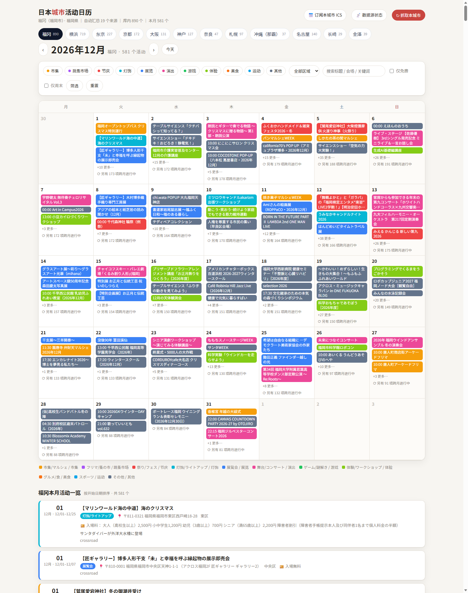

# 日本热门城市活动日历（多城市统一版）

一个把日本 12 个热门城市的**活动、市集、跳蚤市场、祭典、灯饰、展览、演出**自动汇总成月历的小应用：
点城市标签切换，按类别/区域/免费/周末筛选，可导出 ICS 订阅、可离线打开单文件月历。

- 城市：**福冈、横浜、东京、京都、大阪、神户、奈良、札幌、冲绳（那霸）、名古屋、长崎、金泽**
- 数据：2026-11-27 全量抓取，库内 **4,774** 个活动（12 月 **3,253** 个）
- 全部为公开网页自动采集，**没有演示数据、没有手写假条目**



## 线上部署（Render）

- 线上地址：**https://japan-city-events.onrender.com**
- 仓库：https://github.com/duanzhilong999-commits/japan-city-events
- Render：Blueprint `Japancity`（`render.yaml`）→ Web Service `japan-city-events`，Python 3、Free 计划、Singapore 区域
- 数据更新：GitHub Actions `每日刷新活动数据`，每天 04:10（日本时间）跑 `collect --city all` 并把 `data/events.db` commit 回 main；Render 检测到推送自动重新部署
- 注意：Free 实例闲置 15 分钟后会休眠，下次访问首屏要等约 50 秒唤醒；数据库在容器内是临时的，重部署会回到仓库里的版本（所以靠 Actions 提交 DB 来保新鲜）
- 手机订阅：`https://japan-city-events.onrender.com/calendar.ics?city=all`（单城市把 `all` 换成 `fukuoka`/`yokohama`/`tokyo` 等）

## 快速开始

```powershell
# 抓取全部城市（约 5–8 分钟）
..\.venv\Scripts\python.exe -m app.cli collect

# 启动网页 http://127.0.0.1:8100
.\start.ps1
# 或
..\.venv\Scripts\python.exe -m uvicorn app.web:app --host 127.0.0.1 --port 8100

# 其它
..\.venv\Scripts\python.exe -m app.cli stats                  # 各来源状态
..\.venv\Scripts\python.exe -m app.cli list --city kyoto     # 命令行查看
..\.venv\Scripts\python.exe -m app.cli ics --city all        # 导出 ICS
..\.venv\Scripts\python.exe -m app.cli static --month 2026-12 # 每城市一个离线 HTML
..\.venv\Scripts\python.exe -m app.cli verify --limit 24      # 抽样回源验证链接
```

## 产物清单（2026-12）

| 文件 | 说明 |
|---|---|
| `docs/2026-12/index.html` | 12 城市索引页（含各城当月条数），双击即可离线打开 |
| `docs/2026-12/<city>.html` | 每城市一个单文件月历（内联 CSS，无外部依赖） |
| `japan-cities-2026.ics` | 全城市订阅文件，4,670 个 VEVENT（Google/Apple 日历可直接导入） |
| `docs/img/cities-*.png` | 网页版预览截图 |
| `data/events.db` | SQLite 库，4,774 条活动 + 每源抓取日志 |

## 数据源（全部为各城市本地来源，城市之间不共用站点）

| 城市 | 来源 | 站点 | 抓取内容 |
|---|---|---|---|
| 福冈 | 19 个本地源 | 福岡観光ナビ / crossroad / ウォーカープラス福岡 / 福岡市科学館 / 福岡市市場 / アジア美術館 / 福岡市美術館・博物館 / キャナルシティ / 福岡タワー / アクロス福岡 / 博多座 / 商店街 / rapinc / konohen 等 | 综合活动、市集、展览、演出 |
| 横浜 | 6 | 横浜市公式「市民利用施設等イベント情報」`cgi.city.yokohama.lg.jp`、横浜赤レンガ倉庫、横浜美術館、三溪園、観光かながわNOW、ウォーカープラス神奈川 | 官方活动、仓库活动、展览、庭园活动 |
| 东京 | 2 | GO TOKYO（东京都官方观光，展覧会列表）、ウォーカープラス东京 | 展览 + 综合活动 |
| 京都 | 2 | 京都市公式 京都観光Navi、ウォーカープラス京都 | 综合活动、夜间活动 |
| 大阪 | 1 | ウォーカープラス大阪（按「大阪市」过滤） | 综合活动（见下方限制） |
| 神户 | 2 | Feel KOBE 神户公式观光、ウォーカープラス兵库 | 综合活动 |
| 奈良 | 2 | 奈良国立博物館（公式）、ウォーカープラス奈良 | 展览 + 综合活动 |
| 札幌 | 2 | ようこそさっぽろ（札幌观光公式）、ウォーカープラス北海道 | 综合活动（含会场/地址） |
| 冲绳（那霸） | 2 | おきなわ物語（冲绳观光情报）、ウォーカープラス冲绳 | 综合活动 |
| 名古屋 | 2 | 名古屋コンシェルジュ（名古屋市观光情报）、ウォーカープラス爱知 | 综合活动 |
| 长崎 | 2 | travel nagasaki（长崎市公式观光）、ウォーカープラス长崎 | 综合活动 |
| 金泽 | 2 | 金沢21世紀美術館（公式）、ウォーカープラス石川 | 展览 + 综合活动 |

**关于「不共用福冈来源」**：福冈的 19 个源（福岡観光ナビ、crossroad、konohen 等）只服务福冈；
其它城市各自使用本地站点。唯一跨城市复用的是「ウォーカープラス」，但它按都道府县分页
（`ar0313` 东京、`ar0726` 京都、`ar0727` 大阪、`ar0728` 兵库、`ar0729` 奈良、`ar1040` 福冈、
`ar1042` 长崎、`ar1047` 冲绳、`ar0101` 北海道、`ar0623` 爱知、`ar0314` 神奈川、`ar0517` 石川），
每个城市请求的是**自己的都道府县页**，再按地址/会场里的城市名二次过滤，不存在「拿福冈数据冒充」。

## 已验证但**没有**接入的站点（2026-11-27 实测，宁可缺也不造）

| 站点 | 实测结果 | 结论 |
|---|---|---|
| `osaka-info.jp/event/`（大阪观光局） | HTTP 200，但 HTML 里 **0 个月/日文本**，列表由前端 JS 渲染 | 未接入 → **大阪只有 walkerplus 一个来源** |
| `hiroshima-navi.or.jp/event/`（广岛） | HTTPS 握手失败（SSLError） | 未接入（广岛也不在首批城市里） |
| `welcome.city.yokohama.jp`（横浜观光） | 连接失败（站点有 JS 挑战） | 未接入，横浜改用市公式 + 各设施官网 |
| `www4.city.kanazawa.lg.jp`（金沢市公式） | HTTP 200 但是门户首页，HTML 里 0 个活动日期 | 未接入 |
| `hot-ishikawa.jp/event/`（石川县观光） | 有 409 条检索结果，但列表由检索接口动态拼装，选择器不稳定 | 暂未接入（金泽目前是 21 世纪美术馆 + walkerplus） |
| `narashikanko.or.jp/event/`（奈良市观光协会） | HTTP 200，但正文里没有「X月X日」文本，是条件检索 UI | 未接入（奈良目前是奈良国立博物馆 + walkerplus） |

## 判定口径

- **时间窗**：抓取日 ±（30 天前 ~ 400 天后）；长期展只要仍在展期内就会进来。
- **城市归属**：每个 Collector 只写自己城市的库（`city` 字段 = 城市 id），跨城去重不会发生。
- **区域**：优先按各城市的区域关键词（如京都「祇园・东山」、东京「丸之内・银座」）判定；
  没有命中时，从地址里抽「XX区」，且只接受该市真实行政区（东京 23 区、大阪 24 区、京都 11 区等），
  宁可留空也不猜。
- **类别**：标题关键词优先（市集/跳蚤市场/祭典/灯饰/展览/演出/游戏/体验/美食/运动），
  标题没有再看简介。
- **跨源合并**：标题相似度 ≥ 0.93 且日期重叠才合并；同一活动会保留多个来源标记。

## 目录

```
app/
  cities.py      城市注册表（名称、都道府县、walkerplus 地区码、区域关键词、会场、行政区校验）
  core.py        日期解析、分类、区域判定、SQLite（含 city 字段）
  collectors.py  通用采集器：Walkerplus / 卡片列表（选择器驱动）/ GO TOKYO / 奈良博 / 金泽21
  fukuoka.py     福冈 19 个本地采集器（从福冈版迁移）
  yokohama.py    横浜 6 个本地采集器
  pipeline.py    按城市调度、写 runs 日志
  web.py         FastAPI：城市标签、月历、筛选、ICS
  cli.py         命令行
  ics.py         ICS 生成（含 VTIMEZONE / VALARM / 折行）
web/             模板与样式
docs/2026-12/    12 月各城市单文件月历（离线可开）+ 索引
docs/img/        预览截图
data/events.db   SQLite（4,774 条）
```

## 加一个新城市

1. 在 `app/cities.py` 的 `CITIES` 里加一项：`name / ja / pref / walker（walkerplus 地区码）/ filters / areas / venues`。
2. 若该市有可静态解析的本地列表页，在 `collectors._cards()` 里加一条 `CardSpec`（选择器需先抓页面确认）。
3. `ORDER` 里加入顺序，重跑 `collect` 即可。

## 2026-11-27 覆盖修正：walkerplus 深翻页

第一版每个城市只翻 20 页（约 200 条），而 walkerplus 都道府県页的实际总量是：
东京 1,316、大阪 593、横浜 553、京都 366、名古屋 358、神户 344、福岡 269。

现在采集器会读取列表页上的「全 N 件」，按每页 10 条自动翻到末页（上限 160 页），各城市库内活动变化：

| 城市 | 修正前 | 修正后 |
|---|---|---|
| 东京 | 227 | **1,946**（walker 1,303 + Tokyo Art Beat 627） |
| 大阪 | 131 | **343** |
| 京都 | 172 | **287** |
| 名古屋 | 140 | **174** |
| 神户 | 127 | **163** |

所以「东京等地活动少」不是缺信息源，而是被翻页上限截断了；东京不需要拆到每个区去抓，
walkerplus 的 `ar0313` 本身就是都道府県级汇总，覆盖 23 区。各区公式页里多出来的主要是
区民讲座、健康体操这类社区活动（和横浜市公式 596 条同质），如果以后想要这种「生活感」的密度可以再接。

## 2026-11-27 二次补源：逐城源审计

翻页修好后仍有城市偏少，逐城实测后的结论是「当地公开活动总量本身就这么大」，不是漏抓：

| 城市 | walkerplus 都道府県页「全 N 件」 | 本版接入源 | 库内 |
|---|---|---|---|
| 东京 | 1,316 | walkerplus + gotokyo + **Tokyo Art Beat** | 1,946 |
| 横浜 | 553（神奈川県） | walkerplus + 横浜市公式 + 赤レンガ + 県观光 + 三渓園 + 横浜美術館 | 721 |
| 福冈 | 269 | walkerplus + 18 个本地源 | 891 |
| 大阪 | 593 | walkerplus + 大阪観光局（JS 页无静态列表） | 343 |
| 京都 | 366 | walkerplus + 京都観光Navi | 287 |
| 名古屋 | 358 | walkerplus + 名古屋観光 | 174 |
| 神户 | 344 | walkerplus + Feel Kobe | 163 |
| 札幌 | 132 | walkerplus + 札幌観光 | 97 |
| 奈良 | 137 | walkerplus + 奈良国立博物館 | 47 |
| 金泽 | 76 | walkerplus + 21世紀美術館 | 39 |
| 冲绳那霸 | 47 | walkerplus + 沖縄ストーリー | 37 |
| 长崎 | 57 | walkerplus + 長崎観光 | 29 |

注：walkerplus 的「全 N 件」是都道府県全域，本版按城市 filters 只留该市，所以库内数会小于该值。

新增 **Tokyo Art Beat**（`tokyo-artbeat`）：解析 `__NEXT_DATA__` 里的 1,656 条展覧会，用会场经纬度框（35.5–35.95 / 139.4–140.0）剔除神奈川・群馬・大阪等外县，按会场区域标签补齐 23 区归属，实测 627 条、12 月在场 479 条。

各区公式页实测结果（不需要拆区）：新宿 403、渋谷 连接失败、豊島 404、世田谷 404、台東 200 但 0 处日期；能拿到的多是区民讲座/健康体操，与横浜市公式 596 条同质，价值低于商业展演。

其他城市候选源实测：`city.osaka.lg.jp`、`city.kobe.lg.jp/event/`、`city.nagasaki.lg.jp/event/`（403）、`www4.city.kanazawa.lg.jp/event/`（仅 2 处日期）、`osaka-info.jp/event/`（JS 渲染，静态 0 日期）、`artexhibition.jp`（报道型文章，非会期列表）——均为公告/门户页，无结构化活动列表，故未接入。

## 质量记录（2026-11-27）

- 抽样 24 条活动链接回源：**24/24 HTTP 200**（含横浜市公式详情页、京都 SAMAC、名古屋市观光、奈良吉野、札幌 STV 等）。
- 各城市 12 月收录：东京 1,383、福冈 582、横浜 531、大阪 228、京都 188、名古屋 117、神户 106、札幌 46、奈良 28、冲绳 25、金泽 14、长崎 13（合计 3,253）。
- 福冈版另有海报基准验收（22/22 命中），见 `../fukuoka-event-radar/README.md`；本版沿用同一批福冈采集器。
- 已知噪音：横浜市公式「市民利用施設」里含大量社区教室/健康体操等非旅游活动（保留，可用类别/区域筛掉）；
  大阪因官方站 JS 化，活动偏少。

## 与旧版的关系

- `../fukuoka-event-radar/`：福冈单城市版（19 源、海报 22/22 验收、端口 8000），保持不变。
- `../横浜活动日历/`：横浜单城市版（6 源），保持不变。
- 本目录是统一版，包含上述两个城市的全部来源，并新增 10 个城市。
